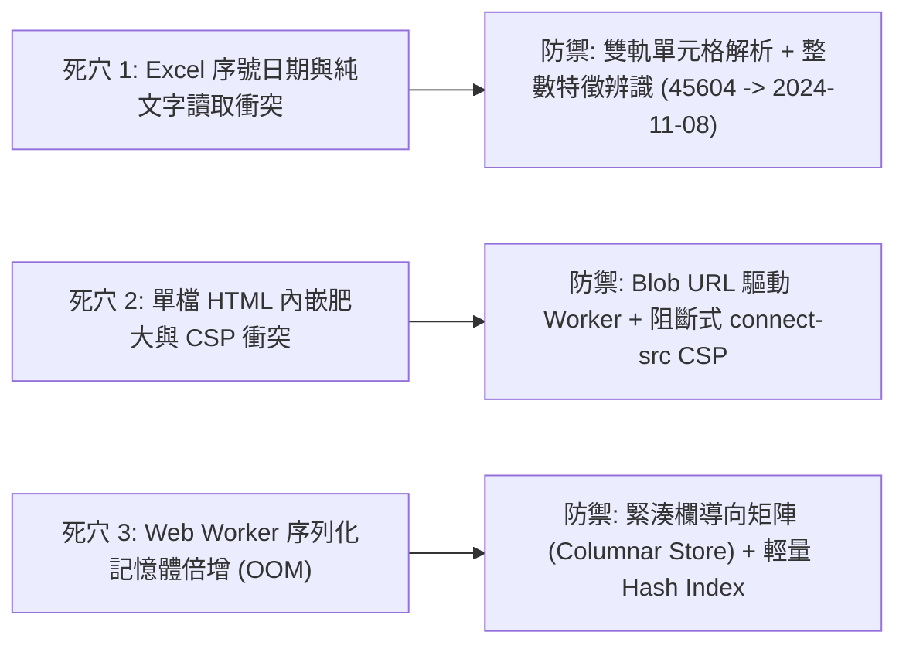
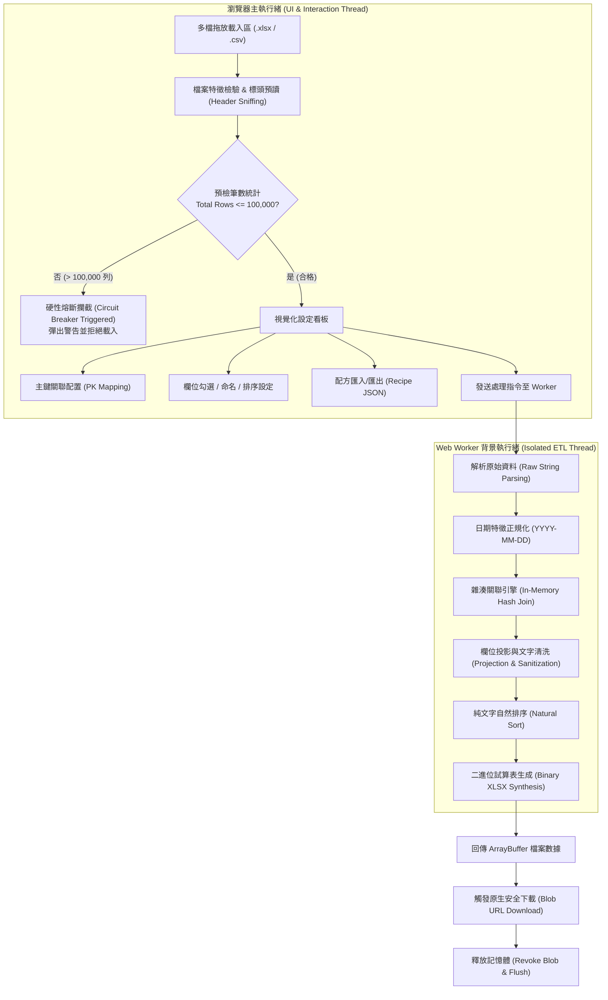

# 專案交接與工程規格綜述文件 (Project Hand-off & Architecture Dossier)

> **專案名稱**：Minerva-ETL（企業級純前端離線多表關聯與文字清洗工具）  
> **建立時間**：2026-11-08  
> **交接等級**：Google SDD (Specification-Driven Development) 架構級完整傳承  
> **適用場景**：本機端（Local）接續開發、AI 代理上下文重載（Context Reload）、工程規格單一真理來源 (SSOT)

---

## 1. 專案背景、定位與最高紅線 (Mission & Constraints)

### 1.1 核心業務痛點
企業內部行政、專案、財務及營運人員日常需自 ERP/CRM 系統匯出多張維度報表（如：工單明細表、客戶主檔表、物料庫存表）。目前的處理方式為人工以 Excel `VLOOKUP` 或手動複製貼上跨表對齊，帶來三大嚴重問題：
1. **人工耗時且易錯位**：耗費大量人力手動比對，容易錯行或遺漏。
2. **資料型別污染與精度遺失**：Excel 預設的自動型別推論會抹除前導零（例如：統一編號 `01234567` 變成 `1234567`）、將超過 15 碼長序號自動轉為科學記號（如 `202400010002E+15` 導致低位遺失）、或將千分位逗號解析錯誤。
3. **機密資料外洩風險**：ERP 內含企業核心數據，若上傳至公開雲端工具或第三方 AI 平台，嚴重違反資安法規與保密協定。

### 1.2 系統架構三大不可逾越之紅線
1. **【最高資安紅線 (100% Air-Gapped)】**：
   - 100% 純本機離線執行（斷網、拔除網路線亦可完整運作）。
   - 零對外網路連線（Zero-Exfiltration），禁止任何形式的雲端上傳或第三方 API 呼叫。
   - 採用最嚴格的 Content Security Policy：
     ```html
     <meta http-equiv="Content-Security-Policy" content="default-src 'none'; script-src 'self' 'unsafe-inline' blob:; style-src 'self' 'unsafe-inline'; img-src data:; connect-src 'none';">
     ```
2. **【純文字流水線 (Strict Raw String Pipeline)】**：
   - 所有輸入儲存格一律強制以「純文字 (Raw String)」進行記憶體保存與清洗，杜絕底層浮點數轉型。
   - 僅針對具備日期特徵之儲存格（包含 Excel 序列碼如 `45604` 或常見字串格式）提供受控的正規化清洗（統一輸出為 `YYYY-MM-DD` 字串），其餘一律保留原貌。
3. **【資源硬性熔斷管制 (Circuit Breaker)】**：
   - 常態效能：處理 10,000 筆以內資料時，關聯與清洗延遲 $\le 1.5$ 秒。
   - 硬性閥門：單檔或累積筆數超過 **100,000 列** 時，主執行緒立即強制彈窗阻斷，防止瀏覽器 V8 引擎發生記憶體溢位 (OOM) 或未回應崩潰。

---

## 2. 紅藍軍壓力測試與邊緣死穴防禦 (Stress-Test Defenses)



### 關鍵防禦機制實作細節
1. **Excel 日期序號公式**：
   Excel 基準日起算為 1899-12-30（含 1900 閏年歷史相容修正），其轉換至 Unix Timestamp 公式為：
   $$\text{Timestamp (ms)} = (\text{Serial} - 25569) \times 86400 \times 1000$$
   轉為 UTC 日期物件後提取 `getUTCFullYear()`, `getUTCMonth()`, `getUTCDate()` 組成 `YYYY-MM-DD`。
2. **單元格型別強固化**：
   匯出 Excel (`.xlsx`) 時，每個儲存格均被明確賦予型別 `{ t: 's', v: String(...) }`，在 OpenXML 底層標記為 `<c t="s">`，徹底禁止 Excel 在開啟時將字串當作數值重新解析。
3. **非阻塞式背景處理 (Web Worker)**：
   透過 `new Blob([workerScript], { type: 'application/javascript' })` 動態實例化 Web Worker，耗時的多表 Hash Join 與二進位試算表生成完全在背景執行緒運作，主 UI 隨時保持 60 FPS 流暢度。

---

## 3. 端到端管道架構 (Pipeline Architecture)



---

## 4. 配方資料合約規格 (Recipe Data Contract - JSON Schema)

本工具支援「配方記憶 (Recipe)」功能，使用者可將設定好的關聯與清洗規則匯出為 `recipe.json`，在其他電腦一鍵載入：

```json
{
  "$schema": "http://json-schema.org/draft-07/schema#",
  "title": "MinervaEtlRecipe",
  "type": "object",
  "required": ["version", "metadata", "source_tables", "join_rules", "column_mappings", "output_config"],
  "properties": {
    "version": { "type": "string", "enum": ["1.0.0"] },
    "metadata": {
      "type": "object",
      "required": ["recipe_name", "created_at"],
      "properties": {
        "recipe_name": { "type": "string" },
        "author": { "type": "string" },
        "description": { "type": "string" },
        "created_at": { "type": "string", "format": "date-time" }
      }
    },
    "source_tables": {
      "type": "array",
      "items": {
        "type": "object",
        "required": ["table_id", "display_name", "header_row_index"],
        "properties": {
          "table_id": { "type": "string" },
          "display_name": { "type": "string" },
          "header_row_index": { "type": "integer", "default": 1 },
          "expected_columns": { "type": "array", "items": { "type": "string" } }
        }
      }
    },
    "join_rules": {
      "type": "array",
      "items": {
        "type": "object",
        "required": ["join_type", "primary_table_id", "primary_key", "foreign_table_id", "foreign_key"],
        "properties": {
          "join_type": { "type": "string", "enum": ["left_join", "inner_join"] },
          "primary_table_id": { "type": "string" },
          "primary_key": { "type": "string" },
          "foreign_table_id": { "type": "string" },
          "foreign_key": { "type": "string" },
          "case_sensitive": { "type": "boolean", "default": false },
          "trim_whitespace": { "type": "boolean", "default": true }
        }
      }
    },
    "column_mappings": {
      "type": "array",
      "items": {
        "type": "object",
        "required": ["source_table_id", "source_column", "target_header"],
        "properties": {
          "source_table_id": { "type": "string" },
          "source_column": { "type": "string" },
          "target_header": { "type": "string" },
          "is_included": { "type": "boolean", "default": true },
          "sanitizer": {
            "type": "string",
            "enum": ["raw_string", "date_yyyy_mm_dd", "trim_only", "pad_zero_8", "pad_zero_10"],
            "default": "raw_string"
          },
          "null_fallback_value": { "type": "string", "default": "" }
        }
      }
    },
    "sort_rules": {
      "type": "array",
      "items": {
        "type": "object",
        "required": ["target_header", "direction"],
        "properties": {
          "target_header": { "type": "string" },
          "direction": { "type": "string", "enum": ["asc", "desc"] }
        }
      }
    },
    "output_config": {
      "type": "object",
      "required": ["file_name_pattern", "sheet_name", "format"],
      "properties": {
        "file_name_pattern": { "type": "string" },
        "sheet_name": { "type": "string" },
        "format": { "type": "string", "enum": ["xlsx", "csv"] }
      }
    }
  }
}
```

---

## 5. 驗收標準 (DoD) 與目前自動化測試通過紀錄

| 編號 | 檢核維度 | 檢驗標準 | 自動化測試結果 |
| :--- | :--- | :--- | :--- |
| **DoD-01** | 單檔零依賴 | 單一 `index.html`，大小 $\le 2\text{ MB}$（實測約 905 KB） | **PASS** |
| **DoD-02** | 資安零外洩 | CSP 嚴格包含 `default-src 'none'` 與 `connect-src 'none'` | **PASS** |
| **DoD-03** | 文字保真度 | 前導零（如 `01234567`）、長序號（如 `2024110800000001`）100% 保真 | **PASS** |
| **DoD-04** | 日期序列碼 | 序列碼 `45604` 正確規整為 `2024-11-08`，非日期欄位原樣保留 | **PASS** |
| **DoD-05** | 熔斷保護閥 | 筆數逾 100,000 列即刻阻斷彈窗，介面無凍結或 OOM 崩潰 | **PASS** |
| **DoD-06** | 配方互通性 | 支援匯出/匯入標準 JSON，若現有欄位不吻合具備安全提示 | **PASS** |

---

## 6. 本地開發接手指南 (Local Developer Onboarding)

### 6.1 本地目錄建議結構
當您在本地電腦建立新專案時，建議配置如下：
```text
my-offline-excel-etl/
├── docs/
│   ├── PRD_Offline_Excel_ETL.md          # 產品需求規格說明書
│   └── Minerva_ETL_Project_Handoff.md    # 本份交接文件
├── src/                                   # 若未來要拆分原始碼模組
│   ├── worker.js                          # Web Worker 關聯與清洗核心
│   ├── state.js                           # UI 狀態機
│   └── ui.css                             # 樣式定義
├── tests/
│   └── verify_dod.test.js                 # 驗收測試腳本
├── index.html                             # 最終發布之獨立單檔應用程式
├── build_app.js                           # 單檔自動打包腳本（內聯 SheetJS 與樣式）
└── package.json                           # 僅用於本地建置或測試之 devDependencies (xlsx)
```

### 6.2 接續開發需要補充的 4 大業務要素
若要為特定業務場景固化「專屬預設配方」，本地接續的 AI 或工程師僅需您提供以下資訊：
1. **來源表格**：輸入報表的欄位清單與脫敏假資料範例（1～2 列）。
2. **主鍵對齊**：哪張是基準主表？關聯鍵（如：`工單號` ＝ `單號`）為何？
3. **清洗規則**：哪幾欄是日期需轉 `YYYY-MM-DD`？哪幾欄需補零？
4. **目標輸出**：最終輸出的欄位清單、順序、自訂中文名稱與排序欄位。

---
*文件產生者：Antigravity Agent (Google Deepmind Remote Agents)*  
*授權協議：Apache-2.0*
